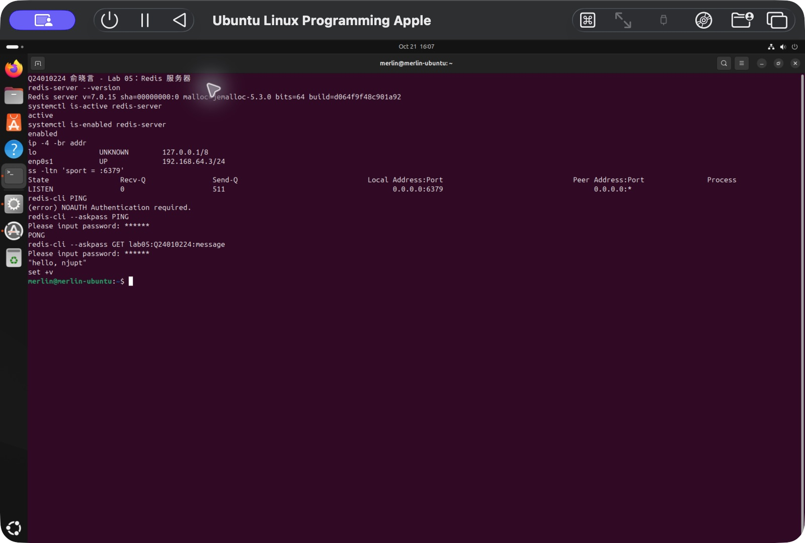
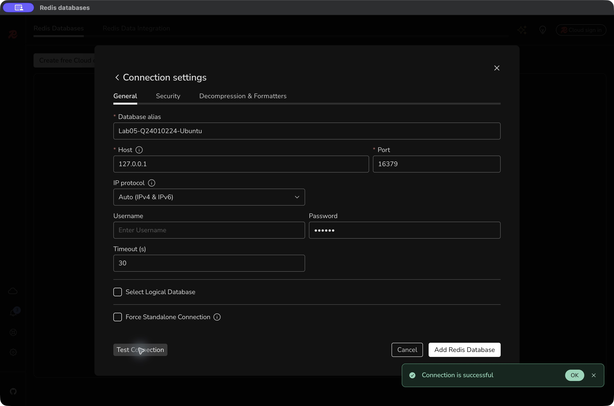

# 实验 05：Redis 服务器搭建与 RedisInsight 连接

## 实验信息

- 学生：俞晓言
- 学号：Q24010224
- 完成日期：2026 年 10 月 21 日
- 服务端：UTM Ubuntu 24.04.4 LTS ARM64，主机名 `merlin-ubuntu`
- 客户端：macOS，Redis Insight 3.8.0（Apple Silicon）
- Redis 版本：7.0.15，软件包版本 `5:7.0.15-1ubuntu0.24.04.5`
- 服务器地址：`192.168.64.3:6379`，UTM 共享网络

## 实验目标

1. 安装 Redis，检查服务运行状态和开机启动状态。
2. 修改监听地址并设置密码，理解监听与认证的区别。
3. 验证未认证访问被拒绝，认证后能够读写数据。
4. 使用 RedisInsight 从 Mac 连接 Ubuntu 的 Redis。

## 一、安装与配置

在 Ubuntu 执行：

```bash
sudo apt-get update                  # 更新本地软件包索引
sudo apt-get install -y redis-server # 安装 Redis 服务及命令行工具
redis-server --version              # 查看 Redis 版本
```

安装后，修改前先备份配置文件：

```bash
sudo cp -p /etc/redis/redis.conf /etc/redis/redis.conf.before-lab05
```

配置文件 `/etc/redis/redis.conf` 中的关键设置为：

```text
bind 0.0.0.0
protected-mode yes
requirepass <实验密码>
```

`bind 0.0.0.0` 让 Redis 监听 Ubuntu 的所有 IPv4 接口；它不是客户端应该填写的目标地址。客户端直连时应填写虚拟机的实际 IP。`requirepass` 要求客户端先认证；报告中的 `<实验密码>` 是占位符，实际配置使用课堂练习密码。`protected-mode yes` 保持开启。本实验使用 UTM 共享网络，未配置路由器端口映射。

修改后重启并检查：

```bash
sudo systemctl restart redis-server # 重新加载配置并启动服务
systemctl is-active redis-server    # 检查当前是否运行
systemctl is-enabled redis-server   # 检查开机启动状态
ss -ltn 'sport = :6379'             # 查看 TCP 6379 端口的监听状态
```

结果分别为 `active`、`enabled`，监听地址为 `0.0.0.0:6379`。

## 二、认证与数据读写

未输入密码，执行：

```bash
redis-cli PING
```

返回：

```text
NOAUTH Authentication required.
```

这表明客户端已经连接到 Redis，但尚未通过认证，并非服务未启动。使用交互式密码输入验证：

```bash
redis-cli --askpass PING
redis-cli --askpass GET lab05:Q24010224:message
```

`--askpass` 提示输入密码，避免把密码直接写入命令行。认证后，第一条返回 `PONG`，第二条返回 `"hello, njupt"`。

此外，从 Mac 向 `192.168.64.3:6379` 直接发送 Redis 协议命令，验证结果如下：

| 操作 | 结果 |
| --- | --- |
| 未认证时执行 `PING` | `NOAUTH Authentication required.` |
| 使用实验密码执行 `AUTH` | `OK` |
| 认证后执行 `PING` | `PONG` |
| `SET lab05:Q24010224:message "hello, njupt"` | `OK` |
| `GET lab05:Q24010224:message` | `hello, njupt` |

`SET` 将字符串写入指定键，`GET` 读取该键的值。测试键带有课次与学号，便于与其他练习数据区分。



## 三、RedisInsight 图形连接

在 Mac 安装适合 Apple Silicon 的 Redis Insight：

```bash
brew install --cask redis-insight
```

首次启动后进入 `Add Redis database → Connection settings`。按课件要求清空用户名，密码填写与服务端一致的实验密码。

最初使用 `192.168.64.3:6379` 直接连接时，RedisInsight 报错：

```text
connect EHOSTUNREACH 192.168.64.3:6379
```

同一台 Mac 的协议客户端已经能够直连、认证并读写，因此不能把这次错误归因于 Redis 服务没有运行或密码错误。图形客户端的局域网访问权限或路由仍需另行检查。本次使用 SSH 本地端口转发完成图形连接测试。

在 Mac 终端执行以下命令，并保持该终端运行：

```bash
ssh -N -L 127.0.0.1:16379:127.0.0.1:6379 merlin@192.168.64.3
```

`-N` 表示只进行转发，不执行远程命令；`-L` 将 Mac 的 `127.0.0.1:16379` 转发到 Ubuntu 的 `127.0.0.1:6379`。前一个回环地址属于 Mac，后一个属于 Ubuntu。

RedisInsight 的最终连接参数为：

| 参数 | 填写值 |
| --- | --- |
| Database alias | `Lab05-Q24010224-Ubuntu` |
| Host | `127.0.0.1` |
| Port | `16379` |
| Username | 留空 |
| Password | 与服务端一致的实验密码 |

点击 `Test Connection` 后显示 `Connection is successful`。此时访问的仍是 Ubuntu 虚拟机中的 Redis，Mac 上没有另装 Redis 服务。SSH 转发结束后，该连接入口也随之失效。



## 实验结论

完成 Redis 安装、监听地址修改、密码认证及服务重启。服务运行和开机启动状态正常；未认证请求被拒绝，认证后能够返回 `PONG` 并读写字符串。Mac 协议客户端直连验证成功，RedisInsight 经 SSH 转发连接测试成功。

## 参考资料

- [Redis 安装与基本连接](https://redis.io/docs/latest/install/install-redis/)
- [Redis 安全与认证](https://redis.io/docs/latest/operate/oss_and_stack/management/security/)
- [Redis Insight 桌面安装](https://redis.io/docs/latest/operate/redisinsight/install/install-on-desktop/)
